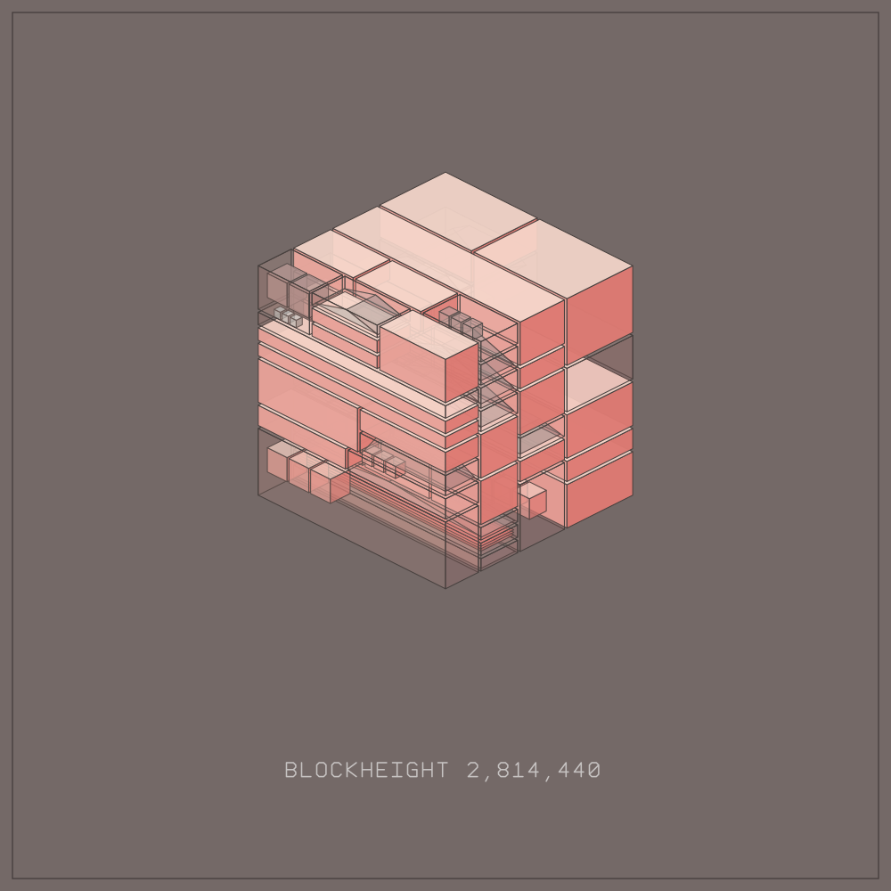

# BlockHeight Art

BlockHeight Artwork is a small, dependency-free TypeScript engine for deterministic generative architectural SVGs. It is the artwork engine of the BlockHeight project (part of Blox), published on its own so that others can render, remix and build on it instead of starting from zero.

**Create the art here. Bring it on chain with [MintGarden Dynamic Minting](https://mintgarden.io/minting-api).** In Blox / BlockHeight, this engine supplies the artwork for a custom NFT minting experience: the application prepares the artwork and metadata, MintGarden creates a Chia offer, and the collector takes that offer in their own wallet. It is a practical way to combine your own generative art studio with MintGarden's minting infrastructure.

Start with our **[MintGarden Dynamic Minting guide](docs/mintgarden-dynamic-minting.md)** for the flow used in Blox, API fields, Mint Credits, offer expiry, royalties and payment verification. The Blox integration has minted on Testnet11; this standalone repository contains the artwork engine and integration documentation, not the live minting backend.

The engine is a pure function: a JSON recipe goes in, SVG text comes out. It does not connect to Chia or any other chain, and it does not mint, sell or store NFTs.

Code imported from [IOI-forge/blockheight-artwork](https://github.com/IOI-forge/blockheight-artwork), retaining the original [MIT license](LICENSE).



## Quick start

You need Node.js 24 or newer. There is nothing to install and nothing to build.

```sh
git clone https://github.com/xchChiaFarmers/blockheight-art.git
cd blockheight-art
npm test
npm run render
```

`npm run render` writes `examples/example.svg` and its recipe `examples/example.json`. To render your own recipe to a separate file:

```sh
cp examples/example.json my-artwork.json   # then edit "params" in the copy
npm run render -- my-artwork.json out/my-artwork.svg
```

This writes `out/my-artwork.svg` and the recipe used next to it (`out/my-artwork.json`). New to Node or SVG? The [step-by-step getting started guide](docs/getting-started.md) walks through it.

## What you can build

- **A custom NFT minting experience with MintGarden**: render an artwork here, publish its immutable files and metadata, then use Dynamic Minting to create a wallet-ready offer. See the [Blox integration pattern](docs/mintgarden-dynamic-minting.md).
- **Your own generator or gallery**: call the engine with your own seeds and option sets, e.g. one image per day, per user or per block.
- **A web studio**: bundle `src/shared/` with your build tool and render in the browser; the modules use no Node or browser APIs.
- **Block-driven art**: read block data with your own chain client, condense it into a [digest](#render-with-block-data) and let the engine draw its events.
- **New styles**: add palettes, options or shapes as a new renderer version (see [Extending the engine](#extending-the-engine)).

## The recipe

Every artwork is described by a recipe. Keep the recipe with the SVG: the same recipe always produces the same SVG bytes.

| Field | Meaning |
| --- | --- |
| `seed` | Exactly 64 lowercase hexadecimal characters. Drives the artistic random choices. |
| `blockHeight` | Positive safe integer. Shown in the caption and mixed into the random choices. It does not fetch any block. |
| `rendererVersion` | `blockheight-1` … `blockheight-4`. Use `blockheight-4` for new work. |
| `params` | One value for every option in the [options table](#options). |
| `chain` | Optional block digest (required for `blockheight-3`). See [block data](#render-with-block-data). |

## Use the engine from code

`renderArtwork` in `src/shared/render.ts` dispatches a recipe to the renderer named in `rendererVersion` and returns an SVG string. It validates the recipe and throws an `Error` on invalid input.

```js
// my-script.mjs, run from the repository root with:
//   node --import ./scripts/typescript-loader.mjs my-script.mjs
import { writeFile } from 'node:fs/promises';
import { renderArtwork } from './src/shared/render.js';
import { studioDefaults } from './src/shared/studio-defaults.js';

const svg = renderArtwork({
  seed: '0123456789abcdef'.repeat(4),
  blockHeight: 2_814_440,
  rendererVersion: 'blockheight-4',
  params: { ...studioDefaults, palette: 'c7', ground: 'grid' },
});
await writeFile('my-artwork.svg', svg);
```

Keep the `.js` import specifiers: the loader maps them to the TypeScript sources, and Node strips the types at runtime. TypeScript projects can import `renderSvg4` and the `Artwork4`/`Art2Params` types from `src/shared/art2.ts` directly. In a browser or another build system, compile or bundle the files in `src/shared/` like any other TypeScript; this repository is not a prebuilt npm package.

`scripts/render.mjs` is a complete working integration in 20 lines.

## Options

`studioDefaults` in [`src/shared/studio-defaults.ts`](src/shared/studio-defaults.ts) is the starting point used by the original BlockHeight web studio and by the example. `blockheight-2` to `blockheight-4` accept these options:

| Area | Option | Values |
| --- | --- | --- |
| Colour | `palette` | `futuradora`, `c1`–`c14` |
| Colour | `mix` | `none`, `little`, `much` |
| Structure | `structure` | `quiet`, `layered`, `dense` |
| Structure | `walls` | `few`, `some`, `many` |
| Structure | `spacing` | `none`, `tight`, `airy` |
| Structure | `shapes` | `few`, `balanced`, `many` |
| Structure | `glass` | `solid`, `mixed`, `glassy` |
| Structure | `lines` | `fine`, `regular`, `heavy` |
| Size and view | `blocksize` | `small`, `medium`, `large` |
| Size and view | `zoom` | `out`, `normal`, `in`, `close` |
| Size and view | `view` | `classic`, `high`, `low`, `flipped` |
| Composition | `composition` | `single`, `chain` |
| Composition | `axis` | `x`, `z`, `vertical` |
| Composition | `satellites` | `one`, `two`, `three` |
| Composition | `reach` | `near`, `mid`, `far` |
| Composition | `wires` | `straight`, `loose` |
| Finish | `frame` | `none`, `thin`, `bold` |
| Finish | `fill` | `none`, `dust`, `panel` |
| Finish | `caption` | `low`, `bottom`, `topleft`, `topright`, `none` |
| Finish | `ground` | `none`, `grid`, `shadow`, `both` |
| Finish | `hatch` | `none`, `light`, `dense` |
| Finish | `twist` | `none`, `slight`, `strong` |
| Finish | `slices` | `none`, `little`, `much`, `fan` |
| Finish | `bevel` | `none`, `subtle`, `bold` |
| Finish | `occlusion` | `none`, `soft`, `deep` |
| Finish | `cutaway` | `none`, `corner` |
| Finish | `material` | `none`, `concrete`, `metal`, `frosted` |
| Finish | `connectors` | `none`, `collars`, `nodes` |
| Finish | `accents` | `none`, `edges`, `shapes`, `wall` |
| Block symbols | `annotations` | `none`, `full` |
| Block symbols | `eventlayout` | `none`, `elongated`, `tiled`, `stacked` |

Good first options to try are `palette`, `frame`, `view` and `composition`; `structure`, `walls` and `blocksize` change the underlying architecture. `composition: chain` draws several connected blocks; it is a visual option and does not enable blockchain access. The finish options from `ground` onwards may be omitted in older recipes and then mean `none`. `annotations` also accepts the retired values `markers` and `explained` so that previously saved artwork still renders; do not use them for new work. `blockheight-1` is an older renderer with its own three-option set; see [`src/shared/art.ts`](src/shared/art.ts).

## Render with block data

Without a `chain` field, `blockheight-4` draws a purely generative design. With one, it also draws symbols for the block's events and, with `annotations: full`, numbered callouts and a legend. The engine never reads a blockchain: your application supplies the digest, and the engine only checks its structure and draws it. A digest is not proof that a block exists.

[`examples/synthetic-digest.json`](examples/synthetic-digest.json) is a complete recipe with **synthetic, made-up** block data; render it with:

```sh
npm run render -- examples/synthetic-digest.json examples/synthetic-digest.svg
```

The digest format is defined and validated in [`src/shared/digest.ts`](src/shared/digest.ts). Every field is required and no other fields are allowed:

| Field | Meaning |
| --- | --- |
| `version` | `2` (current) or `1` (archival, without the `channel`, `dao`, `credential` and `contract` categories) |
| `height` | Block height; must equal the recipe's `blockHeight` |
| `headerHash` | 64 lowercase hexadecimal characters |
| `transactionBlock` | `true` or `false` |
| `timestamp` | Unix seconds or `null` |
| `fees` | Total fees in mojos, as a decimal string |
| `rewards` | `{ "farmer": n, "pool": n }` reward coin counts |
| `spends` | Number of coin spends |
| `events` | A count for each category: `xch`, `cat`, `nft`, `did`, `offer`, `datalayer`, `pool`, `service`, `unknown`, and for version 2 also `channel`, `dao`, `credential`, `contract` |
| `tokens` | Number of distinct CAT tokens moved |

How spends are classified into these categories is up to your application; the original BlockHeight classifier is not part of this repository. `eventlayout` controls how symbols fill their pane: `elongated` stretches them, `tiled` places up to 48 and `stacked` up to 96 on up to three depth layers.

## Determinism and versions

The same validated recipe produces the same SVG bytes on every machine. The output contains no scripts, remote resources or fonts (lettering is drawn as lines), so it looks the same everywhere. PNG conversion is outside this contract because rasterizers differ.

The seed drives an artistic pseudorandom generator, not a cryptographic one. Applications that issue or sell artwork must create and authorize seeds themselves.

Renderer versions are immutable output contracts: an artwork made with `blockheight-2` today must still render byte-for-byte the same later. `blockheight-4` keeps colour, glass and inner-shape choices on separate random streams, so changing them does not reshuffle the walls, and chooses caption ink with at least 4.5:1 contrast to the paper. See [engine design](docs/art-engine.md) for the full version history.

## Extending the engine

Want a new palette, option or shape? Because existing versions must never change their output, add it as a new renderer version (for example `blockheight-5`) and dispatch it in `src/shared/render.ts`. Shared helpers and palettes are used by several versions, so add new ones instead of editing existing ones in place. Validate every new option at runtime and add tests that pin both the new and the old behaviour. [CONTRIBUTING.md](CONTRIBUTING.md) and [AGENTS.md](AGENTS.md) have the details. If you fork the engine for your own project, you are free to change anything; just give your renderer versions your own names so recipes stay unambiguous.

## Project files

| Path | Contents |
| --- | --- |
| `src/shared/render.ts` | `renderArtwork`: dispatch by `rendererVersion` |
| `src/shared/art2.ts` | Renderers `blockheight-2` to `blockheight-4`, option schema (`paramSpec`) and validation |
| `src/shared/art.ts` | The original `blockheight-1` renderer and shared random, glyph and formatting helpers |
| `src/shared/palettes.ts` | Colour palettes |
| `src/shared/geometry.ts`, `event-layout.ts`, `annotations.ts` | Mesh geometry, event symbol placement, callouts and legend |
| `src/shared/digest.ts` | Block digest format and validation |
| `src/shared/format.ts` | Locale-independent number formatting |
| `src/shared/studio-defaults.ts` | Default options |
| `scripts/render.mjs` | Command-line example |
| `scripts/typescript-loader.mjs` | Lets Node run the TypeScript sources with their `.js` import paths |
| `tests/` | Renderer, geometry, annotation, layout and formatting tests |
| `examples/` | Example recipes and their SVGs |
| `docs/` | [Getting started](docs/getting-started.md), [MintGarden Dynamic Minting](docs/mintgarden-dynamic-minting.md), [engine design](docs/art-engine.md), [validation](docs/validation.md), [extraction notes](docs/extraction-plan.md) |

## License

Code, documentation and the example outputs are available under the [MIT License](LICENSE). You may use, modify and distribute them, including commercially, as long as the license notice is kept. The license does not grant rights to the Blox or BlockHeight names, logos or other brand assets.
